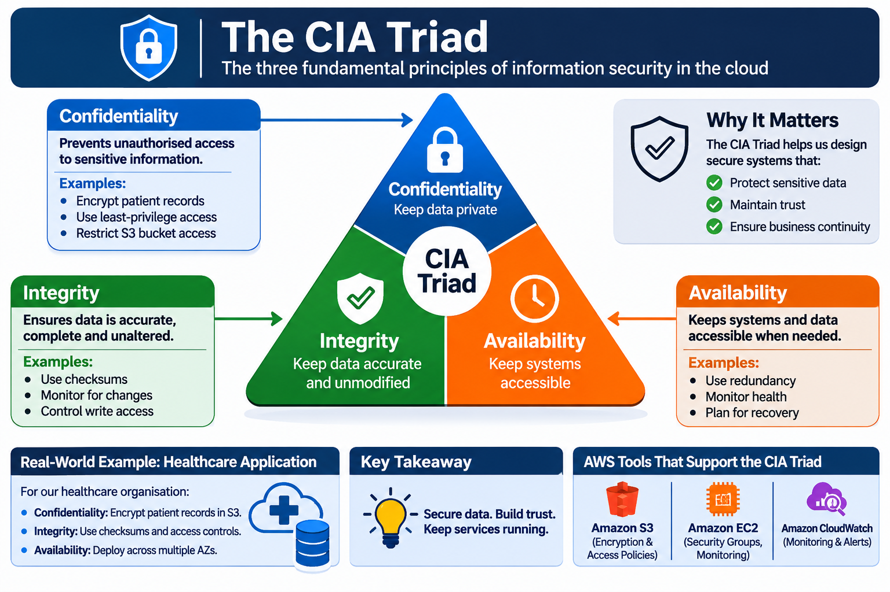

# Practical Exercise 2: CIA Triad Security Analysis

## 1. Objective

Apply the three fundamental principles of information security — Confidentiality, Integrity and Availability — to identify security risks and recommend appropriate controls for a cloud-hosted healthcare application.

## 2. Scenario

A healthcare organisation operates a patient records application hosted on AWS.

Its infrastructure uses:

- Amazon EC2 to host the application.
- Amazon S3 to store patient records.
- AWS IAM to manage access permissions.
- AWS CloudTrail to record account activity.
- Amazon CloudWatch to monitor application performance and availability.

The organisation has identified three potential security incidents that could affect patient information and business operations.

## 3. Understanding the CIA Triad

| Principle | Security Objective | Main Concern |
|---|---|---|
| Confidentiality | Protect sensitive information from unauthorised disclosure | Who can access the data? |
| Integrity | Maintain accurate and trustworthy information | Has the data been altered without authorisation? |
| Availability | Ensure systems and information remain accessible | Can authorised users access the service when needed? |

## 4. Incident Analysis

### Incident A: Confidentiality Breach

**Scenario:**

An employee discovers that patient records can be accessed because an S3 bucket has been incorrectly configured.

**Affected principle:** Confidentiality.

**Potential business impact:**
- Exposure of sensitive patient information.
- Loss of patient trust.
- Regulatory and legal consequences.
- Reputational damage.

**Recommended security controls:**
- Enable S3 Block Public Access where public access is not required.
- Apply least-privilege IAM permissions.
- Use appropriate encryption for stored data.
- Review bucket policies regularly.
- Monitor access activity.

**Relevant AWS services:**
- Amazon S3.
- AWS IAM.
- AWS CloudTrail.
- Amazon Macie.

### Incident B: Integrity Breach

**Scenario:**

An unauthorised user modifies patient records without permission.

**Affected principle:** Integrity.

**Potential business impact:**
- Incorrect patient information.
- Poor medical decisions based on altered records.
- Loss of confidence in the application.
- Potential legal and operational consequences.

**Recommended security controls:**
- Restrict write permissions through IAM.
- Enable S3 Versioning where appropriate.
- Use checksums or other integrity verification mechanisms.
- Monitor changes to sensitive resources.
- Maintain tested backups.

**Relevant AWS services:**
- AWS IAM.
- Amazon S3.
- AWS CloudTrail.
- Amazon CloudWatch.

### Incident C: Availability Failure

**Scenario:**

The healthcare application becomes unavailable during a critical period because its EC2 server experiences a failure.

**Affected principle:** Availability.

**Potential business impact:**
- Healthcare staff cannot access patient records.
- Delays in providing medical services.
- Disruption to business operations.
- Loss of revenue and customer confidence.

**Recommended security and resilience controls:**
- Use multiple Availability Zones where appropriate.
- Implement health monitoring and alerts.
- Maintain regular backups.
- Develop a disaster recovery plan.
- Test recovery procedures.

**Relevant AWS services:**
- Amazon EC2.
- Elastic Load Balancing.
- Amazon CloudWatch.
- AWS Backup.

## 5. CIA Triad Risk Assessment

| Incident | CIA Principle | Likelihood | Impact | Priority |
|---|---|---|---|---|
| Exposed patient records | Confidentiality | High | Critical | Critical |
| Unauthorised record modification | Integrity | Medium | Critical | High |
| Application server failure | Availability | Medium | High | High |

**Note:** These ratings are illustrative assessments for the simulated healthcare scenario, not findings from an actual AWS environment.

## 6. Security Recommendations

The healthcare organisation should implement the following measures:

1. Protect sensitive patient records using encryption and strict access controls.
2. Apply least-privilege IAM permissions.
3. Monitor account activity and configuration changes.
4. Enable appropriate data versioning and backup mechanisms.
5. Implement monitoring and alerting for application health.
6. Design for resilience and test disaster recovery procedures.
7. Conduct regular security assessments.

## 7. Key Findings

This exercise demonstrates that:

- Confidentiality protects information from unauthorised disclosure.
- Integrity protects information from unauthorised modification.
- Availability ensures systems and data remain accessible.
- A single security incident can affect more than one CIA principle.
- Effective cloud security requires a combination of preventive, detective and recovery controls.

## 8. Conclusion

The CIA Triad provides a foundation for evaluating information security risks in cloud environments.

For the healthcare application, protecting patient information requires confidentiality controls, maintaining accurate records requires integrity controls, and supporting continuous access requires availability and resilience measures.

Cloud Security Engineers use these principles when assessing risks, designing security controls and protecting cloud-hosted applications.

## 9. Evidence and Validation

**Exercise type:** Scenario-based security analysis.

**Environment:** Simulated AWS healthcare application.

**AWS resources created:** None.

**Cost incurred:** No AWS resources were deployed.

**Visual evidence:** CIA Triad infographic included in this document.

**Validation:** Three security incidents were analysed against the CIA principles, with corresponding impacts and recommended controls.

**Status:** Completed — Practical Analysis.

## 10. References

- [AWS Security Pillar — Well-Architected Framework](https://docs.aws.amazon.com/wellarchitected/latest/security-pillar/welcome.html)
- [AWS Identity and Access Management](https://docs.aws.amazon.com/IAM/latest/UserGuide/introduction.html)
- [Amazon S3 Security Best Practices](https://docs.aws.amazon.com/AmazonS3/latest/userguide/security-best-practices.html)
- [Amazon CloudWatch Documentation](https://docs.aws.amazon.com/AmazonCloudWatch/latest/monitoring/WhatIsCloudWatch.html)